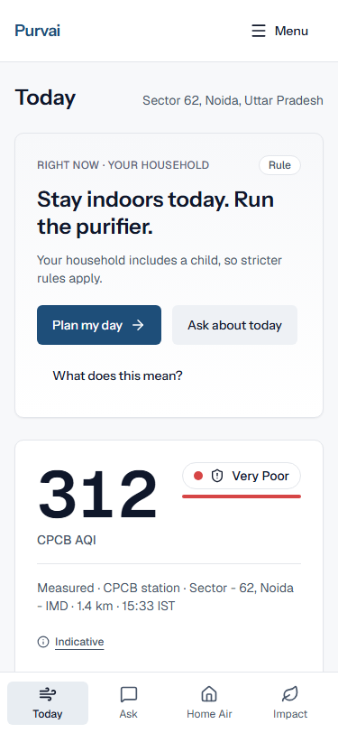
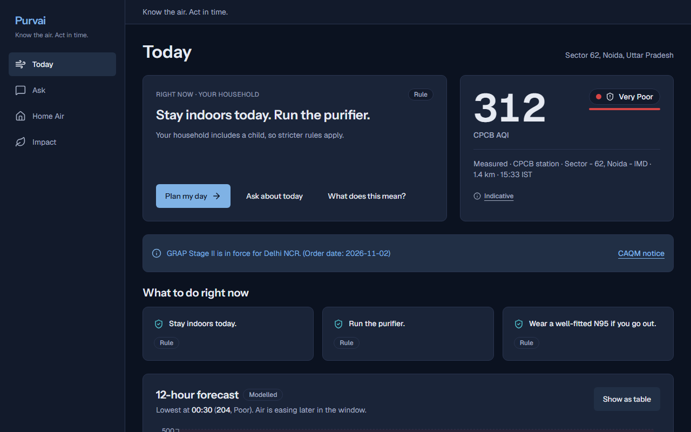
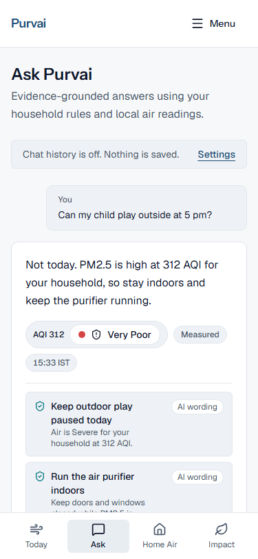
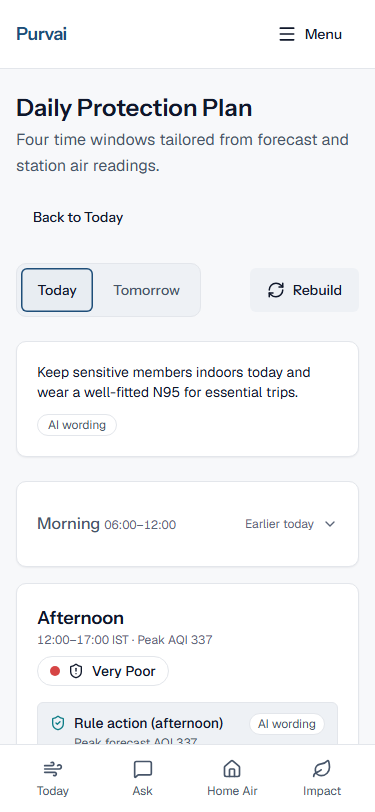

# Purvai

Know the air. Act in time.

Live demo: `[LIVE_URL]` · Technical docs: [docs/README.md](docs/README.md) · Code: https://github.com/vanshdigitals/Purvai



## Chosen Vertical

Urban Air Quality Assistant.

Families in polluted Indian cities see AQI numbers, not decisions. Purvai answers: "What should my family do right now to stay safer?"

| Persona                   | Context        | Need                              |
| ------------------------- | -------------- | --------------------------------- |
| Meera, 36, Noida parent   | Child aged 7   | When to go out, windows, purifier |
| Mr. Sharma, 68, Prayagraj | COPD           | Early warnings, simple words      |
| Ravi, 27, Delhi rider     | Works outdoors | Mask and break guidance           |

## Approach and Logic

**Rules before AI (SAF-01).** A deterministic rules engine decides the safety verdict. The AI only rewords and explains. It cannot change the verdict, household level, action list, AQI, category, GRAP stage, or source label.

**Measured before modelled.** Purvai checks for a CPCB station within 10 km with a reading under 2 hours old ("Measured"). If unavailable (or CPCB times out, opening a 15-minute circuit breaker), it falls back to Open-Meteo CAMS ("Modelled"), or the last cached reading with its age.

**CPCB NAQI maths.** Each pollutant gets a sub-index by linear interpolation inside its CPCB band after truncation. AQI is the highest sub-index (`401+` in Severe). Fewer than 3 pollutants gives an "Estimated" label.

**Household verdict.** Children under 12, adults over 65, and people with heart or lung conditions escalate one level stricter. Outdoor workers get mask and break guidance from Poor. The household gets the strictest verdict as up to 3 actions from a 15-item catalogue.

**Gemini first, Groq second, templates last.** Gemini (`gemini-3.5-flash-lite`) writes wording with a JSON schema. On failure, 15 s timeout, or guard rejection, Groq (`openai/gpt-oss-20b`) gets one try, then Purvai falls back to rule templates ("AI unavailable, showing standard advice").

**The guard.** Replies pass Pydantic validation, then a NFKC-normalised server guard checking verdict level, action IDs, banned medical/drug claims, permissive wording at Poor or worse (unless negated), and grounded numbers (±1) and times. Symptom stems force a "Consult a doctor" note and `out_of_scope=false`.

**Privacy by derived context.** Only AQI, category, source label, pollutants, forecast, verdict, IST times, city, and four boolean flags go to the AI. Names, labels, coordinates, commute modes, and chat history are never sent or logged.

## How the Solution Works

Flow: pick location -> fetch CPCB or Open-Meteo -> compute AQI and household verdict -> show Today actions, 4-period Plan, Ask Purvai, Home Air ACH, and Impact & Reports.

- **Onboarding:** location search or GPS, household cards, commute tiles (skippable after location).
- **Today:** verdict card, AQI hero, GRAP banner (Delhi-NCR), action cards, and 12-hour forecast with table toggle.
- **Plan:** Morning, Afternoon, Evening, Night windows tagged "Rule" or "AI wording" (Today or Tomorrow).
- **Ask Purvai:** air-safety Q&A with data chips, server `grounding_note`, and doctor note.
- **Home Air:** room size plus purifier CADR gives ACH vs target 5, plus indoor tips.
- **Impact & Reports:** commute CO2 savings (ITF-2023), PDF/CSV/JSON export and dry-run import, local SQLite backup/restore, and clear data.
- **Settings:** theme, AI on/off, save chat (off by default), and privacy notice.







### Run locally

Requires Python 3.12 and Node.js LTS. API keys are optional (without them, Purvai uses Open-Meteo and standard advice).

```powershell
git clone https://github.com/vanshdigitals/Purvai.git purvai; cd purvai
Copy-Item .env.example .env
cd backend
py -3.12 -m venv .venv; .\.venv\Scripts\Activate.ps1
pip install -r requirements-dev.txt
uvicorn app.main:app --reload --port 8000
```

In a second terminal:

```powershell
cd frontend
npm ci
npm run dev
```

Open `http://localhost:5173`. Startup runs migrations. Tests: `pytest` in `backend`, `npm test` and `npm run test:e2e` in `frontend`.

## Assumptions Made

- AQI is indicative; official CPCB NAQI uses 24 h and 8 h averages.
- GRAP stage is set manually in `config/grap.json` from caqm.nic.in (Stage II from 2 November 2026).
- Without a fresh CPCB station within 10 km, readings are Modelled estimates from Open-Meteo CAMS.
- Free AI tiers have no guaranteed SLA; unpaid Gemini requests may be human-reviewed, so only derived context is sent.
- Open-Meteo free use is non-commercial.
- Demo data resets on restart and after 24 hours.
- CPCB colour codes are unverified; colour is always paired with the category word.
- Purvai does not give medical advice.

## Evaluation evidence

| Area                        | What we did                                                                                                                                                                                                                                                                                                            | Proof files                                                                                                                                                     | Measured                                                                                                                                                            |
| --------------------------- | ---------------------------------------------------------------------------------------------------------------------------------------------------------------------------------------------------------------------------------------------------------------------------------------------------------------------- | --------------------------------------------------------------------------------------------------------------------------------------------------------------- | ------------------------------------------------------------------------------------------------------------------------------------------------------------------- |
| Code Quality                | Typed Python 3.12 and TypeScript, ruff, mypy strict, eslint, prettier                                                                                                                                                                                                                                                  | `backend/pyproject.toml`, `frontend/eslint.config.js`, `.pre-commit-config.yaml`                                                                                | ruff, mypy (54 files), eslint, tsc: 0 errors                                                                                                                        |
| Security                    | Server-side keys, CSP (`frame-ancestors 'none'`), `X-Frame-Options: DENY`, 64 KB / 5 MB streaming body cap, `slowapi` (`TRUST_PROXY_HEADERS`), demo UUID isolation                                                                                                                                                     | `backend/app/api/middleware.py`, `backend/app/api/rate_limit.py`, `backend/tests/test_security.py`, `backend/tests/test_security_matrix.py`, `docs/SECURITY.md` | `pip-audit`: 0 vulns; `npm audit --omit=dev`: 0 vulns; `gitleaks`: 0 leaks                                                                                          |
| Efficiency                  | 30-min SQLite air cache, 15-min CPCB circuit breaker, lazy chart, immutable `/assets`                                                                                                                                                                                                                                  | `backend/app/aqi/pipeline.py`, `backend/tests/test_perf.py`, `frontend/scripts/check-bundle.mjs`                                                                | PERF-01 p95 `/air`: 30.24 ms; `/today` JS: 127.88 KB gzip; LCP median: 1632 ms (Fast 4G, 4x CPU)                                                                    |
| Testing                     | Fixture-backed backend tests, guard probes, Vitest, Playwright E2E, CI gates                                                                                                                                                                                                                                           | `backend/tests/`, `backend/tests/test_guard_bypass.py`, `frontend/tests/`, `frontend/e2e/`, `.github/workflows/ci.yml`                                          | 271 backend (94.16% cov; `aqi/rules/ai/impact` 94.56%, `impact` 100.00%, `reports` 95.18%); 25/25 probes; 6/6 live AI (6/6 verdict match); 27 Vitest; 20 Playwright |
| Accessibility               | A11Y-01..15: contrast (`--on-danger`), word+number+icon, keyboard & `:focus-visible`, landmarks/`h1`, native/radio, `aria-describedby`, `aria-live`, chart table toggle, `312, Very Poor, CPCB scale, Measured`, 0 ms reduced motion, 200% zoom & 320 px reflow, 44 px targets, Esc modal focus return, `lang="en-IN"` | `frontend/scripts/check-contrast.mjs`, `frontend/e2e/phase6-a11y-perf.spec.ts`, `frontend/src/styles/tokens.css`, `docs/ACCESSIBILITY.md`                       | Contrast: 26/26 pairs >= 5.16:1; axe-core: 0 serious/critical on 12 routes x 2 themes x 2 sizes                                                                     |
| Problem Statement Alignment | Hyperlocal CPCB/Open-Meteo AQI, household verdicts, 4-period plan, Home Air ACH, CO2 tracker                                                                                                                                                                                                                           | `docs/PRD.md`, `backend/app/rules/`, `backend/app/impact/`                                                                                                      | Home Air: 3.5 x 3.0 x 2.8 m, CADR 250 m³/h = 8.5 ACH; 100% verdict matrix                                                                                           |
| Google Services             | Built in Google Antigravity; Gemini API (`gemini-3.5-flash-lite`); Cloud Run-compatible Docker                                                                                                                                                                                                                         | `backend/app/ai/providers.py`, `backend/app/ai/gateway.py`, `Dockerfile`                                                                                        | 6/6 live AI re-test with 6/6 verdict match                                                                                                                          |

## Google technologies used

- **Google Antigravity:** built phase by phase (using Gemini 4 Hydrogen, Gemini 3.8 Flash, and Claude Opus 4.6 inside Antigravity).
- **Gemini API (`gemini-3.5-flash-lite`):** primary runtime model for Ask Purvai and Plan wording via `google-genai` JSON schema, with Groq `openai/gpt-oss-20b` fallback.
- **Hosting:** Render free Docker web service (Cloud Run-compatible image; Cloud Run billing unavailable due to `OR_BACR2_59`).
- **Claude Code:** used only for an independent code review and drafting documentation, not product code.

## Data sources and credits

- Central Pollution Control Board (CPCB) via data.gov.in (GODL-India).
- Open-Meteo Air Quality, Forecast, and Geocoding APIs.
- Copernicus Atmosphere Monitoring Service (CAMS) via Open-Meteo (CC BY 4.0).
- ITF/OECD (2023) India passenger transport lifecycle CO2e factors.

## Limitations

- CPCB data.gov.in timeouts trigger the 15-minute circuit breaker and Modelled fallback.
- AQI readings are indicative real-time windows, not official 24 h averages.
- GRAP stage is updated manually in `config/grap.json`.
- Demo data resets on restart and every 24 hours.
- Free AI tier limits are account-specific and not guaranteed.
- FR-10 compare, FR-12 history, and `ImpactExplanation` AI wording are not built.
- Not medical advice; consult a doctor if symptoms persist.

## Live demo

`[LIVE_URL]` (first load may take about a minute on the free host).
