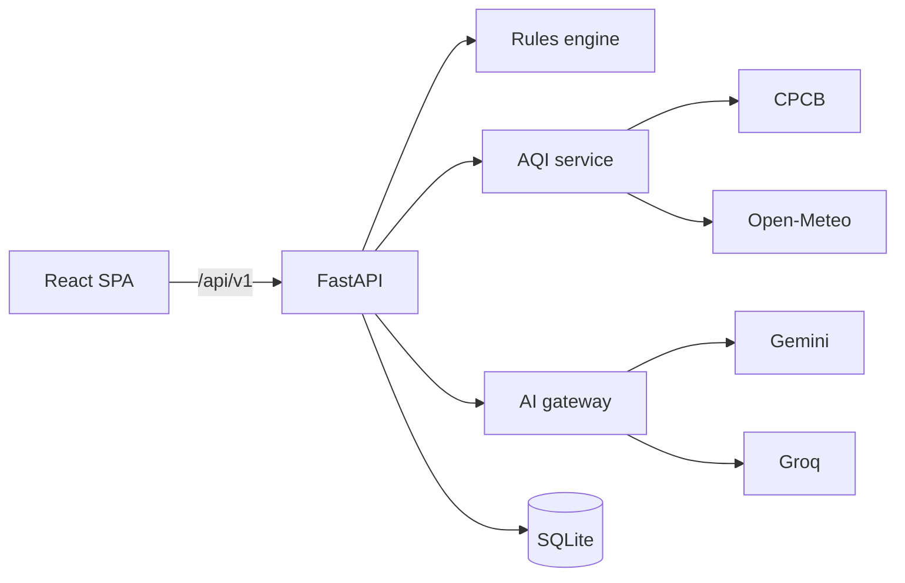
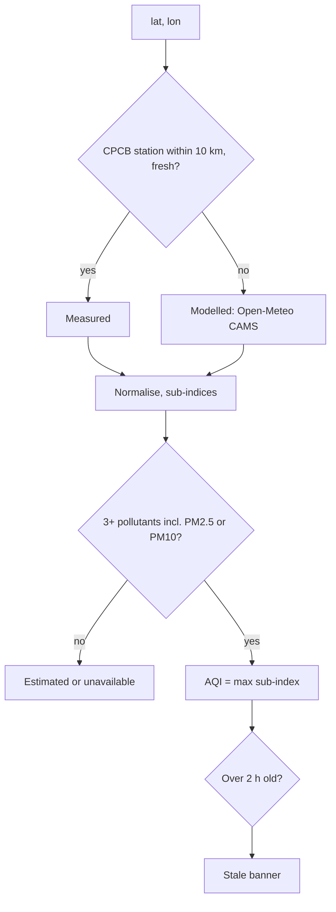

# Architecture (owner of system design)

Principles: rules before AI; measured before modelled; one code path for both modes; fail to cached, labelled data; only derived AI context leaves the device.

## Execution modes
| | Local (persistent) | Hosted demo (temporary) |
|---|---|---|
| Runs on | localhost:8000 | Cloud Run asia-south1, max 1 instance |
| SQLite | `data/purvai.db`, survives restarts | `/tmp/purvai.db` in memory, lost on restart |
| Households | One | One per browser (UUID in localStorage) |
| Retention | Until deleted | 24 h or restart |
| DB backup | Yes | Disabled; JSON export allowed |
This is option A plus a temporary option B. Option C (browser storage) is rejected because it needs a second storage path. SQLite-WASM/OPFS not verified. Litestream unnecessary for MVP.

## Modules
Backend: `api`, `providers`, `aqi`, `rules`, `ai`, `impact`, `reports`, `db`. Routers call services; services never import routers. Frontend: feature folders today, plan, ask, home-air, impact, reports, settings; TanStack Query; CSS-variable themes.

## AQI pipeline

Sub-index I = ((Ihi - Ilo) / (Bhi - Blo)) x (C - Blo) + Ilo. Averaging: 24 h for PM, NO2, SO2; 8 h for CO, O3. Real-time windows are shorter, so results are labelled "indicative".

| Band | AQI | PM2.5 | PM10 | NO2 | O3 8h | CO mg/m³ 8h | SO2 |
|---|---|---|---|---|---|---|---|
| Good | 0-50 | 0-30 | 0-50 | 0-40 | 0-50 | 0-1.0 | 0-40 |
| Satisfactory | 51-100 | 31-60 | 51-100 | 41-80 | 51-100 | 1.1-2.0 | 41-80 |
| Moderate | 101-200 | 61-90 | 101-250 | 81-180 | 101-168 | 2.1-10 | 81-380 |
| Poor | 201-300 | 91-120 | 251-350 | 181-280 | 169-208 | 10.1-17 | 381-800 |
| Very Poor | 301-400 | 121-250 | 351-430 | 281-400 | 209-748 | 17.1-34 | 801-1600 |
| Severe | 401-500 | 250+ | 430+ | 400+ | 748+ | 34+ | 1600+ |
PM rows are baseline-verified. Gas rows come from the CPCB 2014 NAQI table and were not re-fetched; re-check in Phase 2. US EPA (2024 PM2.5 Good 0-9.0) is for outside India only. Never mix or convert scales. WHO 2021 reference lines: PM2.5 15 (24 h), 5 (annual); PM10 45, 15.

## Rules engine
| Category | General | Sensitive (child, over 65, heart or lung) |
|---|---|---|
| Good / Satisfactory | Normal | Normal; watch symptoms at Satisfactory |
| Moderate | Reduce long exertion | Limit prolonged outdoor exertion |
| Poor | Exercise indoors; windows closed at peaks | Mostly indoors; mask outdoors |
| Very Poor | No outdoor exercise; N95 outdoors | Stay indoors; purifier on |
| Severe | Avoid going out | Stay indoors; doctor if symptoms |
Sensitive members escalate one level earlier. Outdoor workers get mask and break guidance from Poor. Household verdict = strictest member. GRAP from `config/grap.json` {stage, order_date, source_url}, edited by hand. Stages: I 201-300, II 301-400, III 401-450, IV above 450.

## Recommendation and AI pipeline
Rules pick action IDs from a fixed catalogue. AI may only reword them and explain. Flow: derived context, primary provider (15 s), schema validation, guard (verdict match, banned claims). On failure: fallback once, then template. Replies carry `generated_by`.

## Caching, errors, offline
Air and forecast cached in SQLite for 30 min by lat/lon rounded to 2 decimals. Provider failure serves the last entry with its age. Offline shows the cached view with "Offline, data from HH:MM". Error format: [API.md](API.md#errors).

## Deployment
Multi-stage Dockerfile: Node builds `dist`; Python slim serves API and static files. Cloud Run: `--max-instances=1 --region=asia-south1`, `PURVAI_MODE=demo`, Secret Manager, budget alert INR 100. Stay inside the free tier and delete the service after judging. Render free runs the same image as backup.

## Extensibility
New AI providers implement `LLMProvider`. Auth maps users to `household_id`. A desktop package can bundle local mode.
