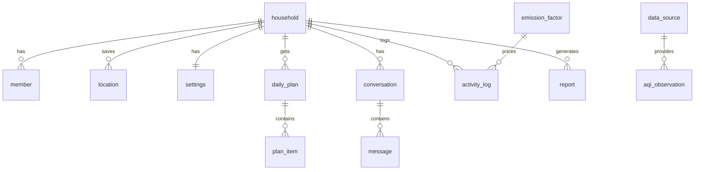

# Database (owner of persistent data)

## Why SQLite
Zero cost, one file, no server, and Python's standard library has an online backup API. Limits: one writer at a time, unsafe on network or FUSE filesystems. So the demo uses instance storage treated as temporary ([modes](ARCHITECTURE.md#execution-modes)).

## Location and connection
Local `DATABASE_PATH` (default `./data/purvai.db`, folder created on start); demo `/tmp/purvai.db`. `create_engine("sqlite:///...", connect_args={"check_same_thread": False})`. Per connection: `PRAGMA foreign_keys=ON; PRAGMA journal_mode=WAL; PRAGMA busy_timeout=5000; PRAGMA synchronous=NORMAL;`. One session per request via a FastAPI dependency.

## Tables
| Table | Columns | Constraints, indexes |
|---|---|---|
| household | id TEXT PK uuid4, mode, created_at, updated_at, expires_at NULL | CHECK mode IN ('local','demo'); idx expires_at |
| member | id PK, household_id FK, kind, count INT | CHECK kind IN ('child_u12','adult_65p','heart_lung','outdoor_worker','adult'); UNIQUE(household_id, kind) |
| location | id PK, household_id FK, label TEXT(60), lat, lon REAL, city NULL, admin1 NULL, admin2 NULL, is_primary | CHECK ranges; partial UNIQUE(household_id) WHERE is_primary |
| settings | household_id PK/FK, theme, commute_mode, ai_enabled, save_chat default 0, reduce_motion | CHECK enums (`commute_mode` includes `bus`, `car`, `auto`, `none` alongside granular transport modes) |
| data_source | id TEXT PK ('cpcb','open_meteo'), name, licence, attribution_text, url | none |
| aqi_observation | id PK, source_id FK, station_id NULL, lat_r, lon_r, observed_at, kind, source_label, pollutants JSON, aqi NULL, fetched_at | CHECK kind IN ('current','forecast'); CHECK source_label IN ('Measured','Modelled','Estimated'); UNIQUE(source_id, lat_r, lon_r, observed_at, kind); idx (lat_r, lon_r, observed_at) |
| daily_plan | id PK, household_id FK, plan_date, verdict_level, aqi_observation_id FK NULL, generated_by, created_at | UNIQUE(household_id, plan_date); CHECK generated_by IN ('rules','gemini','groq','template') |
| plan_item | id PK, plan_id FK, period, action_id, text TEXT(200), tag | CHECK tag IN ('rule','ai_wording') |
| conversation | id PK, household_id FK, started_at | written only when save_chat=1 |
| message | id PK, conversation_id FK, role, text TEXT(600), generated_by, created_at | CHECK role IN ('user','assistant') |
| emission_factor | id TEXT PK, mode, g_co2e_per_pkm REAL, basis, source, version | UNIQUE(mode, version) |
| activity_log | id PK, household_id FK, kind, mode, replaced_mode, distance_km, hours, factor_id FK, co2_saved_g (all nullable except kind), occurred_at | CHECK distance_km BETWEEN 0 AND 500; idx (household_id, occurred_at) |
| report | id PK, household_id FK, format, days, created_at, byte_size | CHECK format IN ('pdf','csv','json'); metadata only |
Child FKs use `ON DELETE CASCADE`. Timestamps are ISO 8601 UTC TEXT set by the server. Impact lives on `activity_log` with its factor ID, so no impact table. `aqi_observation` is the shared air cache; its `pollutants` JSON column stores `{"values": {"pm25": ...}, "station_name": ..., "city": ..., "lat": ..., "lon": ...}` (with station metadata omitted for `open_meteo` rows).

## Seed: emission_factor ITF-2023 (life-cycle gCO2e per passenger-km)
car_petrol 162, scooter 74, motorcycle 65, auto_cng 75, auto_diesel 104, bus_diesel 28, bus_diesel_ac 46, bus_cng 31, metro 24, walk 0, cycle 0. Source: ITF/OECD "Life-Cycle Assessment of Passenger Transport: An Indian Case Study" (2023). India GHG Program 2015 tailpipe factors (city bus 0.015161 kg CO2/pkm) are a cross-check only. Shown after A-02.

## Migrations
Alembic with `render_as_batch=True`. `alembic upgrade head` on start in both modes (`0001_initial_schema` base schema; `0002_location_admin` adds `city`, `admin1`, `admin2` on `location` and extends `ck_settings_commute_mode` and `ck_daily_plan_generated_by`; `0003_emission_factor_seed` seeds the 11 ITF-2023 modes idempotently, with `COMMUTE_MODE_MAP` in `app/impact/factors.py`). Seeds are idempotent upserts. Every schema change needs a migration and an export-format check.

## Backup, restore, export, import
Backup: `sqlite3.Connection.backup()` to `data/backups/purvai-YYYYMMDDTHHMMSSZ.db`, safe while running; keep last 7. Restore: `PRAGMA integrity_check` on a temp copy, check `alembic_version` (`409` on mismatch), safety backup, atomic swap, reset pool. Export: JSON `{"schema":1,...}`. Import: validate, dry-run, single-transaction replace of household members, locations, settings, and activities.

## Retention, integrity, future auth
Observations 8 days; plans and activities until deleted; demo households 24 h. `PRAGMA quick_check` on start; failure marks `/health` as degraded (`503`). Future auth adds `user` and `household_user`; existing rows keep `household_id`.
