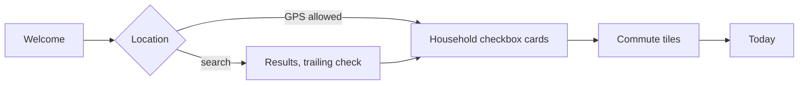

# User Journeys (owner of flows)

Navigation: bottom nav on mobile, sidebar at 1024 px and above: **Today, Ask, Home Air, Impact**. The profile menu holds Reports & Data and Settings.

## Onboarding (under 60 s)

GPS denied goes to search. Household and commute are skippable.

## Journeys
- **Today:** verdict line; AQI, category word, scale and source labels; GRAP banner (Delhi-NCR); three action cards; 12-hour forecast; pollutants collapsed. "What does this mean?" opens the band table and source explanation.
- **Daily plan:** 4 periods, 1 to 4 items each, tagged Rule or AI wording. Today/Tomorrow segmented control; Tomorrow is Modelled.
- **Ask Purvai:** suggested questions, answers with data chips, standard advice if AI fails, history only when enabled.
- **Home Air:** room size plus CADR gives ACH against target 5; tips follow the verdict.
- **Travel and impact:** compare modes as tiles, log the trip, see weekly totals labelled "Estimated" or "Pending" until A-02.
- **Reports and data:** 1 or 7 days (segmented), format option cards, download. Import shows a count preview before confirm. Backup and restore in local mode only. Clear data needs "DELETE".
- **Settings:** theme, AI personalisation, save chat, reduce motion, locations, source credits.

## States
| State | Behaviour |
|---|---|
| Loading | Skeletons; verdict area keeps height |
| Empty | Impact: "Log your first trip"; Ask: suggestions |
| Error | Plain message, retry, cached data if any |
| Stale | Amber banner with age |
| Offline | "Offline, showing data from HH:MM"; network actions disabled |
| Demo | FR-18 banner |
